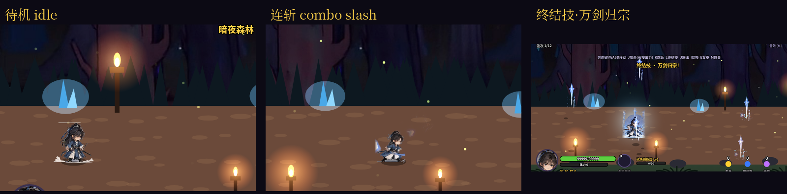

# 青衣剑客 · 五关乱斗

一款带 2.5D 纵深的横版过关清版动作游戏（参考《三国战纪》《恐龙快打》）。纯 HTML5 Canvas + JavaScript，无任何外部网络依赖；音效与音乐由 Web Audio 实时合成。

- 在线试玩：<https://menghao11.github.io/forest-brawler/>
- 本地：用浏览器打开 `index.html`（或任意静态服务器）即可。



## 操作

| 按键 | 功能 |
|---|---|
| 方向键 / WASD | 移动（左右 + 上下纵深） |
| J | 攻击（连击）；长按蓄力（Lv4 剑气波）；前方向 + J 突刺（Lv3） |
| K | 跳跃（空中 J 为下劈） |
| L | **终结技·万剑归宗**（怒气满 100） |
| U | 施放当前魔法（HUD 图标显示冷却、魔力消耗与等级） |
| I | 切换魔法（HUD 右侧小图标是下一个） |
| E | 与女巫交谈 / 关闭菜单 |
| 女巫菜单 | Q / Tab 切换「魔法 / 装备商店」页；←→ 选择系别，↑↓ 选择法术，J 学习或升级；也可鼠标 / 触摸直接点选 |
| B | 关卡选择界面打开装备商店（K / Esc 返回） |
| M | 静音开关 |
| P / Esc | 暂停 + 帮助面板（操作说明、音量滑条；音量保存在存档） |
| 回车 / 点击 | 选关、结算、重新开始 |

### 手机 / iPhone 触控

触屏设备自动显示虚拟按键（请横屏；竖屏会提示「请横屏游戏」）。支持多点触控，可边移动边攻击。

| 触控 | 功能 |
|---|---|
| 左侧虚拟摇杆 | 8 方向移动（含纵深） |
| 攻击 / 跳跃 | 同 J / K（长按攻击蓄力） |
| 终结技 | 怒气满时发光 |
| 魔法 / 切换 | 同 U / I；按钮里直接画出当前 / 下一个法术图标、冷却转圈与魔力消耗 |
| 女巫 | 靠近女巫时出现；菜单中直接点选法术学习 / 升级，点「装备商店」页签买装备，点「关闭」退出 |
| 装备商店 | 点一下选中，再点一次购买 / 装备 |
| 音 | 静音开关 |
| 暂停 | 打开暂停 / 帮助面板（点「继续游戏」或再点「继续」返回） |

iOS Safari 可「添加到主屏幕」全屏游玩；首次触摸后启用音频。

## 战役

| 关 | 名称 | 首领 | 特色 |
|---|---|---|---|
| 1 | 暗夜森林 | 哥布林酋长 | 入门，哥布林刀盾 / 长矛兵 |
| 2 | 雪岭寒关 | 大雪人 | 小雪人 / 木棒雪人 / 雪球雪人 / 冰甲雪人（`ref/snowman_sheet.png` 精灵）；首领用 `ref/snowboss_sheet.png` 动作帧：锁链冰锤挥击、砸地冰锥喷发、冰锥召唤、巨雪球投掷、冰霜冲击波、滚动巨雪球、召唤小雪人；表情头像；火弱冰抗 |
| 3 | 熔岩火山 | 焰魔王·赤烎 | 地裂喷发、陨石、熔岩桥；掉落烈炎剑 |
| 4 | 溪谷森林 | 哥布林大王 | 弓手、跳斩手、木桥、浅溪，战旗 |
| 5 | 黑夜古堡（FINAL） | 吸血伯爵 | 蝙蝠 / 巨蝠、残影大王重战、王座大厅、血月；通关解锁 NG+ |

第 1–4 关 18 波、第 5 关 16 波，再加多阶段首领，含精英波与每关 4 处女巫休息点（真人每关约 8–12 分钟）。进度、最佳时间与成长自动保存在浏览器（localStorage）；在女巫处学会的法术立即存档。详细设计见 [`docs/关卡设计.md`](docs/关卡设计.md)。

## 系统

- **主角**：青衣剑客精灵。待机（6 帧，8fps）、行走（8 帧，12fps，与 200px/s 移速同步；跑步复用行走）、四段普攻 atk1–atk4（各 6 帧，约 18–20fps，第 4 帧剑伸出时判定，收招最后约 1/3 可输入缓冲接下一段；熟练度 2 级起第 5 段为旋风斩）与受击（3 帧）来自新逐帧设定图 `ref/hero_frames_v2.png`，经 `tools/hero_v2_cut.py`（rembg BiRefNet）+ `tools/hero_v2.py`（棋盘格感知清理、补回被误删的灰色剑身、统一比例 / 脚底锚点、按躯干中心平滑水平锚点防抖）打包进 `assets/hero_atlas.png`，HUD 头像取自 idle_01 脸部；跳跃（6 帧：起跳下蹲 / 上升 / 顶点 / 下落 / 伸腿 / 落地缓冲，帧内脚底在基线、高度由代码 z 轴提供）、突刺冲锋（6 帧：起势 / 蓄力 / 刺出 / 全身前冲 / 回剑 / 收势，仅在刺出与前冲帧位移）、旋风斩（8 帧，03–05 为正面 / 背面 / 侧面转体，约 17fps，两段判定）来自 `ref/jump_01~06.png`、`ref/thrust_01~06.png`、`ref/whirlwind_01~08.png`（288×192，锚点见 `ref/new_moves_anchors.json`），同样由 `tools/hero_v2.py` 裁包围盒打包、按 0.625 缩放绘制；其余动作沿用旧图集 `assets/hero_atlas_v1.png`（原 `ref/hero_sheet.png` 切图）并整体色相偏移到新青绿配色：转身、横斩、升斩、下劈、剑气、闪避、格挡、蓄力、终结技、倒地。切图脚本保证每帧只有一个人物（去除残影 / 斩击光弧 / 相邻帧残片、去灰边），所有帧统一脚底锚点与比例；动画帧率约为旧版 1.6–1.9 倍，攻击可在收招阶段输入缓冲接下一段，帧数少的动作带挤压 / 位移补间，缩放绘制开启平滑。敌人图集同样经过 `tools/clean_atlas.py` 清理（每帧只留主体、去半透明灰边与标签框、剔除残片帧）；第二关大雪人使用专用设定图 `ref/snowboss_sheet.png`，经 `tools/snowboss2.py`（rembg BiRefNet 抠图 + 去灰边 + 统一锚点）切出待机、行走、挥击、砸地、冰锥召唤、投掷、冲击波、死亡帧及冰锥 / 巨雪球特效与 HP 条表情头像，稀疏帧间用补间衔接。
- **场景道具**：灯具与灌木 / 草丛使用 `ref/props_sheet.png` 立绘（`tools/props_cut.py` 用 rembg BiRefNet 抠图并缓存到 `ref/props_cut/`，`tools/props.py` 去灰边、保留地面石块底座、统一底线锚点并预缩放打包为 `assets/props_atlas.png`）。灯具放在走道后方中景，带闪烁的加色光晕与地面光池（火盆火焰另成一层，拉伸摇曳并飘火星）；中景灌木 / 草在走道后方，走道下沿零星草丛参与深度排序；近景层为预先压暗、模糊的大号灌木 / 草（视差 1.25×），玩家走到其后方时自动淡出。每关按主题搭配：暗夜森林（木灯柱 / 石柱吊灯 / 火盆、深绿灌木 / 蕨 / 蓝花丛）、雪岭（蓝水晶灯、雪灌木、霜草）、火山（石火盆、枯黄草、零星红叶丛）、溪谷（木灯柱 / 石柱灯、花丛 / 黄绿灌木、芦苇、蕨、花草）、古堡（哥特红双灯 / 石柱壁灯、红叶丛）。
- **关卡节奏**：开局约 1 秒后第一波即触发（不必先走到触发点），入场敌人在接近前以 2.2–2.4 倍速冲入，3–5 秒内接敌。每波敌人分批增援入场（场上剩 ≤1 只时下一批冲入）。
- **近战名额**：同时最多 2 个（第 1 关）/ 3 个（其余关）近战敌人进攻，其余在外圈游走等待，出招后让出名额。第 1 关前期敌人伤害降低（第 1 波 60%，到第 9 波恢复 100%，NG+ 不降）。
- **远程节奏**：所有远程敌人共用射击间隔（第 1 关 1.4 s，其余 1.25 s），弓箭伤害 ×0.8；第 4 关最后几波减员并分 3 批增援。
- **关卡选择**：单击已解锁关卡卡片直接开始；←→ 选择后 Enter/J/空格开始；默认选中上次玩的关卡；存档变动（刷新/其他标签）自动同步。
- **提示消息**：所有提示走同一个消息队列，分 3 条固定道（y=122 警示 / 关卡名，y=150 信息：经验、施法名、装备，y=178 操作提示：冷却、离开标记等），每道同时只显示 1 条、带半透明底，后来的排队（排队时当前条加速淡出）；连续击杀经验合并为一条「+N 经验」。重复文字不叠加；伤害数字自动错开。
- **受击反馈**：受伤时全屏红闪 + 红色暗角；生命低于 25% 时屏幕边缘红色脉动警示。战败界面有 0.8 秒输入保护，连按攻击不会误触「重新挑战」。不闪避的自动脚本实测：第 1–4 关约 5.2–6.0 分钟，第 5 关约 7.3 分钟。
- **掉落**：金币、魔力瓶（+20 魔力，满时不拾取）、淬炼石（武器淬炼 +1 = 攻击 +4、护甲淬炼 +1 = 防御 +2）；精英 20% 掉装备，首领必掉装备（焰魔王 → 烈炎剑、哥布林大王 → 大王战甲、吸血伯爵 → 血月吊坠，其余首领按关卡品质随机）。**掉落装备不会自动替换已装备的**：空槽位直接装上；否则放进背包并弹出提示（暂停游戏，显示属性 ▲▼ 变化）——J / 攻击键「立即装备」，K / 跳跃键「留在背包」，也可直接点按钮；重复装备自动卖成金币（可买装备半价，首领专属 100+品质×120）。没捡的装备过关时也会收进背包并逐件提示。结算页列出本关全部掉落（已装备 / 在背包 / 重复卖出）。
- **金币**：小怪掉 1–2 枚、精英 6 枚、首领 24 枚，每枚面值随关卡 1/2/4/6/7；清完一波后剩余金币自动飞向主角，过关时没捡的也一并计入；首次通关奖励 200/300/400/500/600（重复通关减半）。实测全拾取每关约 630 / 990 / 1280 / 1770 / 2280 金币（累计 630 / 1620 / 2900 / 4680 / 6960），魔力瓶掉率 15%。
- **装备**：武器 / 护甲 / 饰品三个槽位，各 4 档可购买 + 1 件首领专属（共 15 件，`equip.js`）。属性：攻击、生命、防御、暴击率（暴击 ×1.6，黄色大字）、Boss 伤害 +%、法术伤害 +%、魔力上限、魔力回复。价格按每关金币收入定价：1 档 250–300（打完第 1 关买得起一件）、2 档 750–900（第 2–3 关）、3 档 1800–2000（第 4 关左右）、4 档 3600–4200（需要重复刷关）。在关卡选择界面「装备商店 (B)」或女巫营地的「装备商店」页购买；右侧面板显示当前装备与总属性，选中物品时显示装备后的 ▲▼ 变化。装备、背包、金币存入 localStorage；旧存档自动迁移（烈炎剑变成装备，魔法瓶换算成魔力）。
- **装备 × 首领追赶系数**：追赶系数只看**关卡进度**（之前的关卡都通关了 = ×1；跳关时按差距放大，最多 ×5），与当前攻击无关，乘在全部近战伤害（基础 + 装备）上，Boss 伤害 % 与暴击另外乘算——固定攻击 10 时 Boss+30% 实测正好 ×1.30，攻击 16 对 10 正好 ×1.60。追赶系数不作用于法术。
- **怒气 / 终结技**：命中或受伤积累怒气，满后按 L 释放「万剑归宗」——飞剑雨锁定屏内每个敌人。
- **魔法**：击杀获得经验，在女巫处学习火 / 冰 / 雷三系共 16 个法术（同系按顺序）。施放消耗**魔力**（上限 100 + 饰品，每秒回复 0.5 + 饰品，魔力瓶 +20），每个法术有独立冷却，另有**公共冷却**（基础 0.8 秒 / 中阶 1.2 秒 / 终极 2 秒，期间不能施放任何法术，换系也不行）。伤害按攻击力倍数：基础法术（火球、冰锥、连锁闪电，15 魔力）约 2–3 倍普攻一击；中阶 30–40 魔力、冷却 5–10 秒（100 魔力约放 2–3 个）；终极（烈焰冲击 / 冰龙术 / 雷暴领域 / 天雷降临）70–80 魔力、冷却 26–32 秒，约 10–12 倍普攻。首领只受 60% 法术伤害，且不吃追赶系数。三系定位：**火 = 灼烧 / 范围**（命中附加 3 秒灼烧持续掉血，连续火球带小爆炸）；**冰 = 减速 / 冰冻**（命中必减速，冻结的敌人受到非冰伤害 +30%「碎冰」）；**雷 = 连锁 / 爆发**（连锁闪电弹跳，电刃斩命中再连锁，雷系暴击率 +15%）。已学法术可在女巫处用经验升级到 Lv3：伤害 +30% / +60%、冷却 -12% / -24%，火系灼烧 +1 秒/级、冰系控制时间 +25%/级、雷系连锁 +1/级。HUD 中间显示当前法术图标（冷却转圈 + 剩余秒数、右下魔力消耗、上方等级点），右侧小图标为下一个；魔力条平滑过渡，消耗时留残影、拾取时闪光、不足时变红抖动。特效来自 `ref/magic_sheet.png`。
- **女巫美术**：人物帧来自 `ref/witch/`（待机 4 帧、施法 4 帧，256×208、脚底 y=200、锚点 x=128、面朝左，按 0.625 绘制；半身像），由 `python3 tools/witch_pack.py` 打包为 `assets/witch_atlas.png/.json/.js`（含裁好的圆形头像）。坩埚和绿光仍由代码画在她身后；教学 / 升级法术、买装备时播放施法帧。换图：覆盖 `ref/witch/` 中同名文件 → 运行脚本 → 版本号加一；没有图集时自动退回旧的代码绘制。
- **砍杀熟练度**：近战命中累积，30 / 120 / 300 / 600 分别解锁旋风斩、突刺冲锋、剑气波、终结技强化。
- **音效**：Web Audio API 合成全部音效与背景音乐。

## 文件

- `index.html` — 入口
- `stages.js` — 五关配置（背景、波次、危害；替换背景改这里）
- `game.js` — 游戏逻辑、敌人 / 首领 / 法术数据、绘制
- `equip.js` — 装备数据（`@EQUIP-DATA` 块）、掉落、装备商店界面、女巫图集绘制
- `docs/equipment.csv` — 装备表（id, slot, tier, stats, price, name, description, lore），给文案编辑；改完运行 `node tools/equip_csv.js import` 回写 `equip.js`（`check` 只校验、`export` 从游戏数据重新导出）。description / lore 以「【待写】」开头视为占位，不在游戏里显示；填写后 description 会显示在商店选中物品的提示行
- `tools/witch_pack.py` — 女巫图集打包
- `audio.js` — 程序化音效与音乐
- `touch.js` — 移动端触控
- `assets/` — 精灵图集（主角、哥布林、大哥布林、蝙蝠、吸血伯爵、法术特效）与各关远景
- `ref/` — 原始美术参考图
- `docs/关卡设计.md` — 关卡设计文档
- `screenshot_stage2_boss.png` — 第二关大雪人首领战截图（冰锥召唤）
- `screenshot_snowboss_check.png` — 大雪人切图帧检查表（脚底基线对齐、特效与表情头像）
- `screenshot_props_s1.png` … `screenshot_props_s5.png` — 五关场景道具（灯具光晕 / 灌木 / 草丛）截图
- `screenshot_props_check.png` — 道具图集检查表（底线对齐、黄色十字为光源位置，下排为近景压暗版）
- `screenshot_anim_check.png` — 主角新帧逐帧接触表（红线为脚底基线、蓝线为锚点，末行为头像与调色后的旧帧）
- `anim_preview.gif` — 主角待机 / 行走 / 四段连斩 / 受击预览动图
- `screenshot_shop.png` / `screenshot_witch_shop.png` / `screenshot_shop_mobile.png` — 装备商店（关卡选择界面 / 女巫营地 / iPhone）
- `screenshot_magic_hud.png` / `screenshot_magic_hud_mobile.png` — 新魔法 HUD（桌面 / iPhone 触屏按钮图标）
- `test_playwright.js` / `test_mobile.js` / `test_round5.js` — 无头浏览器测试（开发用，需 `npm i playwright-core` 与本机 Chrome；`test_round5.js` 覆盖装备商店、存档迁移、法术冷却 / 升级 / 灼烧、iPhone 法术按钮；`test_round8.js` 覆盖伤害日志 / 统计 / 金币日志、start(n) 1 起、atk() 作用于法术；`test_round7.js` 覆盖公共冷却、首领法术 ×0.6、固定攻击下 Boss 伤害%、装备提示 J/K/点按、结算掉落、消息分道、调试命令、女巫传送）
- `tools_goldsim.js` / `tools_spellbench.js` — 平衡测量脚本（自动打完各关统计金币；对首领 / 木桩测每个法术伤害，`STAGE=0 node tools_spellbench.js`）

## 调试命令（浏览器控制台）

| 命令 | 作用 |
|---|---|
| `__dbg.god()` / `__dbg.god(false)` | 开/关真无敌：任何来源（敌人、投射物、地形陷阱、落雷）都不扣血、不会死亡；整页有效，切换关卡后仍保留 |
| `__dbg.atk(10)` / `__dbg.atk(1)` | 纯调试倍率：玩家**全部**伤害 ×10（普攻、技能、剑气、终结技、法术、灼烧、连锁）/ 恢复正常，各种比例不变；整页有效。HUD 攻击显示「攻 220(×10)」，右上角红字「调试：全部伤害 ×10（含法术）」（无敌时显示「调试：无敌」） |
| `__dbg.start(n)` | 直接开始第 n 关，**按关卡编号从 1 起**：`start(1)` = 第 1 关 … `start(5)` = 第 5 关（未解锁会自动解锁；`start(0)` 无效并提示） |
| `__dbg.skip(n)` | 跳到第 n 波（自动夹在有效范围内，`skip(99)` = 首领波） |
| `__dbg.killAll()` | 杀死场上全部敌人（首领最后结算） |
| `__dbg.unlockAll()` / `__dbg.resetSave()` | 解锁全部关卡 / 重置存档 |
| `__dbg.speed(n)` | 游戏速度 ×n（0 = 冻结） |
| `__dbg.gold(n)` / `__dbg.gear('w4')` | 加金币 / 直接装备某件装备 |
| `__dbg.give(exp, mp)` / `__dbg.resetCd()` | 加经验和魔力（关卡外直接写进存档）/ 清空法术冷却 |
| `__dbg.witch()` / `__dbg.witch(i)` / `__dbg.witch('here')` | 传送到前方下一个女巫营地 / 第 i 个营地 / 在身边召唤女巫（按 E 交互） |
| `__dbg.witches()` | 列出每关女巫营地位置 |
| `__dbg.dmgLog(30)` | 用 `console.table` 打印最近 30 条伤害记录（环形缓冲保留 200 条），并返回数组。列：`t` 关内时间、`stage`、`src` 来源（「普攻 第3段」「旋风斩 (第5段) 1」「跳劈」「突刺冲锋」「剑气波」「终结技 万剑归宗」「火球术 Lv2」「火球术 Lv2 · 灼烧」「爆裂火球 Lv1 · 爆炸」「连锁闪电 Lv1 · 连锁弹跳 2」；玩家受击时为敌人名「哥布林刀盾兵」或「地形 · 地裂」）、`target`、`isBoss`、`raw` 原始值、乘数 `atkDbg` / `catchUp` / `bossPct` / `spellBoss` / `spellPct` / `resist` / `crit` / `other`（格挡、石像、碎冰等），`final` 最终值（= raw × 全部乘数；玩家受击记录 `def` 减伤） |
| `__dbg.dmgLog('clear')` | 清空伤害日志 |
| `__dbg.dmgStats()` | 按「来源 → 敌人 / 首领 / 玩家」汇总：次数、原始合计、最终合计、平均、最大（`console.table` + 返回数组） |
| `__dbg.goldLog()` | 本次打开页面后每关结算的金币：总计、拾取金币、通关奖励、重复装备卖出、结算后余额 |

示例：
```js
__dbg.start(2); __dbg.god(); __dbg.atk(1)   // 第 2 关，无敌
__dbg.dmgLog('clear')                       // 打一会儿首领……
__dbg.dmgLog(20)                            // 看最近 20 下：catchUp / bossPct / spellBoss 各是多少
__dbg.dmgStats()                            // 哪个技能 / 法术总伤最高
__dbg.goldLog()                             // 打完几关后看每关金币
```

**女巫营地位置**（在这些波次打完后出现）：第 1 关 3、7、11、15 波后（共 18 波）；第 2 关 3、7、11、15（18）；第 3 关 3、7、12、16（18）；第 4 关 3、7、11、15、17（18）；第 5 关 3、6、10、13（16）。

- **首领追赶系数**：按关卡进度——前面关卡都通关了就是 ×1；跳关时按该关与已通关进度的预期攻击（10/26/42/62/80）之比放大近战伤害（最多 ×5，新存档直接打第 2–5 关约 ×2.25 / 3.39 / 4.72 / 5）。只作用于近战 / 剑气 / 终结技，不作用于法术。
- **落雷预警**：第 5 关落雷落下前约 1 秒，地面出现闪烁的紫色准星圈、光柱和 ⚡ 标记。

### 装备描述与背景故事
- 商店和女巫菜单的「装备商店」页，右侧面板有两个页签：**属性**（当前装备 + 总属性及变化）和 **说明**（选中物品的名称、品质、属性、描述、背景故事）。
- 切换：点页签，或按 **V**。描述也会显示在商店底部的提示行。
- 文字自动换行（中文逐字，标点不放行首）。故事过长时可滚动：鼠标滚轮、PgUp/PgDn、面板里的 ▲▼，iPhone 上可直接上下拖动。
- 不滚动能完整显示的长度（约）：描述一行 16 字（女巫菜单）/ 20 字（关卡商店）；背景故事约 96 字（女巫菜单）/ 189 字（关卡商店），更长也不会截断，只是需要滚动。
- 测试：`node test_lore.js`（桌面 + iPhone）。
